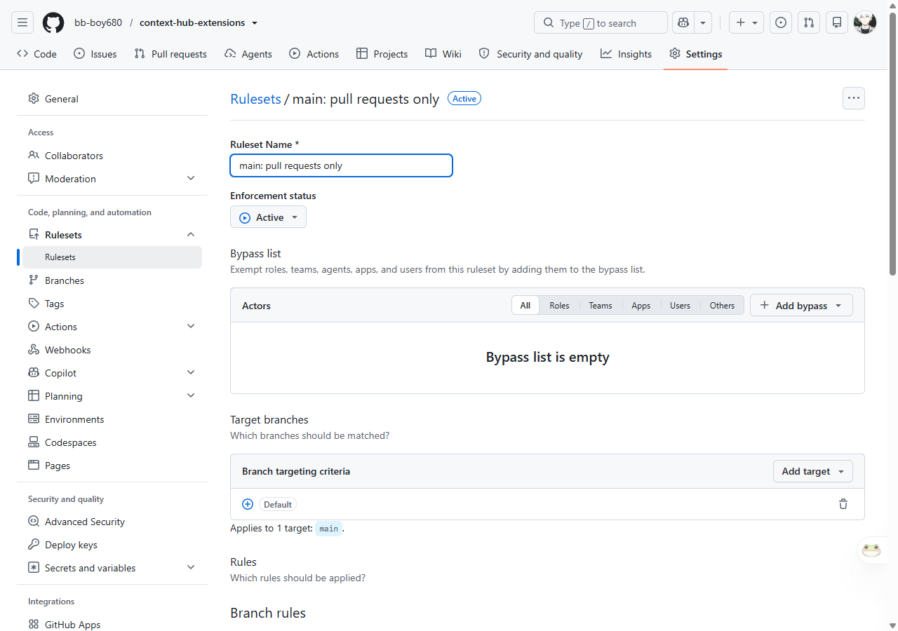
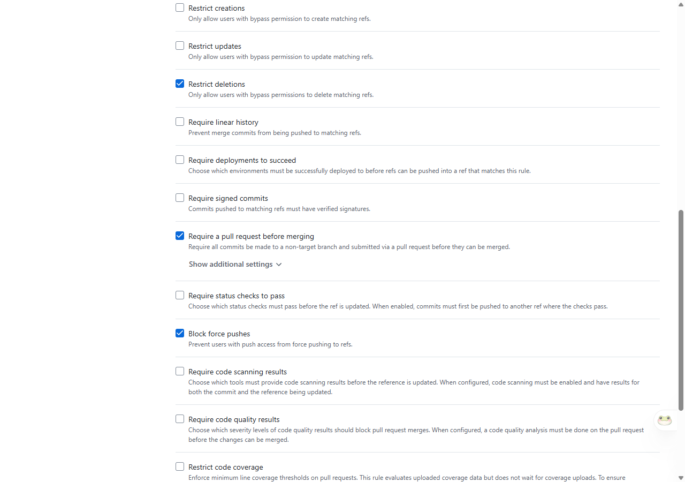
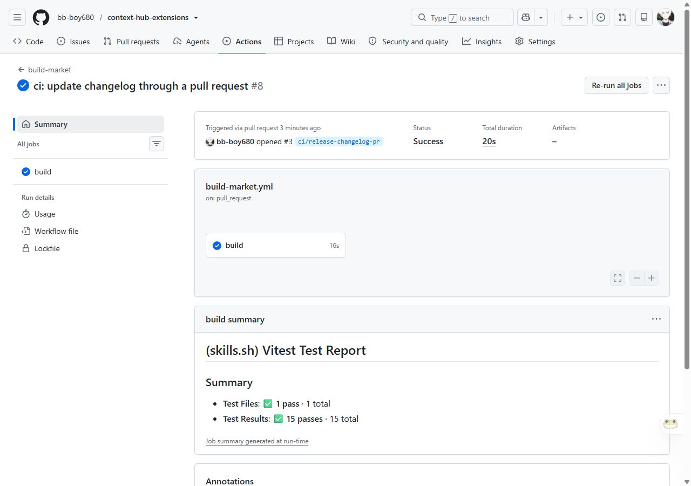
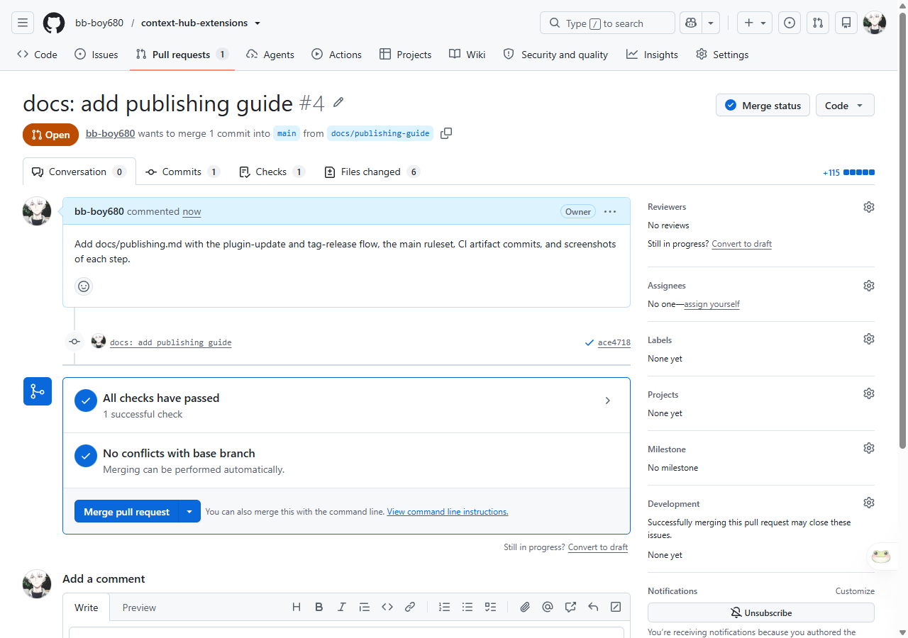
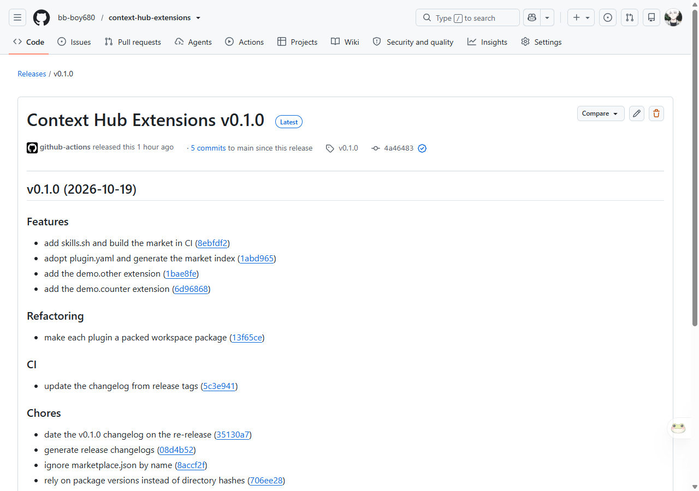

# 发布插件与市场索引

这个仓库同时存放插件源码和 Context Hub 读取的市场索引。两种“发布”要分开看：

| 你要做的事 | 需要 tag 吗 | 结果 |
| --- | --- | --- |
| 让 hub 看到插件的新版本 | 不需要 | PR 合并后 `marketplace.json` 和 `lib/` 更新 |
| 生成 GitHub Release 和 CHANGELOG | 需要 | 打 `v*` tag，`release.yml` 创建 Release 并更新 CHANGELOG |

## 前置：main 只能通过 PR 修改

`main` 由仓库 ruleset `main: pull requests only` 保护：



- 目标分支：默认分支 `main`
- Require a pull request before merging（0 个必需批准，作者可以合并自己的 PR）
- Restrict deletions
- Block force pushes
- Bypass list 为空：管理员也不能直接 push



## 日常发布：插件更新

1. 从最新的 main 拉一个分支：

   ```sh
   git checkout main
   git pull --ff-only
   git checkout -b feat/my-plugin
   ```

2. 修改插件源码，并**升 `package.json` 的 `version`**。
   每个要发布的插件都要升版本；不升的话，市场索引里的版本字符串不变，
   hub 不会显示“可更新”。

3. 在本地跑检查：

   ```sh
   pnpm install
   pnpm lint
   pnpm typecheck
   pnpm test
   pnpm build
   ```

4. 只提交源码，推分支：

   ```sh
   git add plugins/my-plugin
   git commit -m "feat(my-plugin): ..."
   git push origin feat/my-plugin
   ```

5. 在 GitHub 上开一个到 `main` 的 pull request。

6. `build-market` 会在 PR 上运行 lint、typecheck、test、build。
   成功后，它把生成的 `plugins/*/lib` 和 `marketplace.json` 提交回
   **PR 分支**（机器人提交带 `[skip ci]`）：

   

7. PR 页面显示检查通过后合并：

   

8. 合并即完成市场发布。hub 下一次检查更新或重启页面时读取 main；
   索引有 5 分钟缓存。

## 版本发布：tag 与 Release

先合并发布 PR，再在 main 的最新提交上打 tag：

```sh
git checkout main
git pull --ff-only
git tag v0.2.0
git push origin v0.2.0
```

tag 会触发 `release.yml`：

1. 跑 lint、typecheck、test、build。
2. 从上一个 tag 到当前 tag 的提交生成 release notes，创建或更新
   GitHub Release。
3. 开一个 `chore/release-v0.2.0-<run>` PR 更新 `CHANGELOG.md`，并自动合并。
   这个 PR 由 Actions token 创建，不会触发新的 CI run。



要点：

- tag 指向已经在 main 上的提交；分支保护只拦分支，不拦 tag。
- **不要在 PR 合并前打 tag**。那样 tag 指向的提交还没有 CI 生成的
  `lib/` 和 `marketplace.json`，Release 对应的产物会是旧的。
- 自动更新 CHANGELOG 的 PR 路径需要 `pull-requests: write`，
  已在 `release.yml` 里声明。

## 不要做的事

- 不要 `git push origin main`：ruleset 会拒绝，管理员也一样。
- 不要手改 `marketplace.json`：它由 CI 生成。
- 不要往源分支提交 `plugins/*/lib/`：它们由 CI 写回 PR 分支。
- 不要 force-push `main`。

## 参考

- `.github/workflows/build-market.yml`：PR 构建与生成物回写
- `.github/workflows/release.yml`：tag 发布与 CHANGELOG PR
- `README.md`：插件格式、市场索引和本地验证
